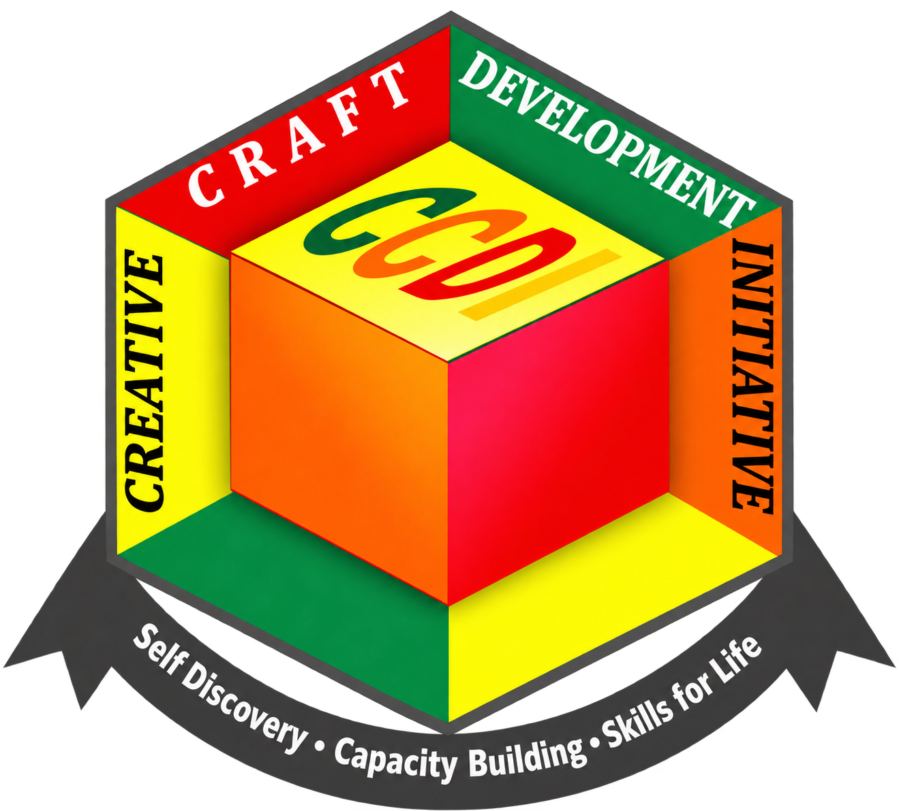

# Creative Craft Development Initiative (CCDI)

The CCDI website, built with **Next.js App Router, React and TypeScript** and exported as a static site. It presents the organisation’s skills development, social enterprise, benevolent and childcare, and community initiatives using supplied copy, photographs, videos, testimonials and documents.

The homepage carousel has six slides: the CCDI introduction, management with vision and mission, and one slide for each of the four project arms. Carousel content lives in `src/components/hero.tsx`; it reuses the organisation’s supplied statements and approved photographs.

The homepage also previews all eight supplied publication covers, a publication-unveiling film and the three existing journal articles. The publication list is shared with the resources page; article previews reuse the blog data. The standalone board/management section lives on the About page and is linked from “Who we are.”

## Getting started

Requires **Node.js 20.9 or newer** and npm. Node.js 24 is used in the current development environment.

```bash
git clone https://github.com/daezy/creative-ccdi.git creativecdi
cd creativecdi
npm ci
npm run dev -- --port 3124
```

Open [http://localhost:3124](http://localhost:3124). Changes to the source update the local preview automatically while the development server is running.

## Production build

```bash
npm run build
npm run check:export
```

The production website is generated in **`out/`**. Deploy that directory to a static host; a Node.js server is not required at runtime.

To preview the exported files locally, with Python 3 installed:

```bash
python3 -m http.server 3125 --directory out
```

Open [http://localhost:3125](http://localhost:3125).

`npm run start` runs Next.js’s server command and is **not the preview command for this static-export configuration**. Use the development server or serve `out/` as shown above.

### Production domain

The confirmed production origin is **https://creativecdi.org**. Canonical links, sitemap URLs, structured data and social previews use this domain by default. To use a different deployment origin, set it before building:

```bash
NEXT_PUBLIC_SITE_URL=https://your-domain.example npm run build
```

Copy `.env.example` to `.env.local` for local configuration. Use `NEXT_PUBLIC_ALLOW_INDEXING=false` on a publicly accessible staging deployment, then rebuild. The owner-private Sites preview retains its existing access settings; it is not accessible to search and social crawlers. Environment files are ignored by Git; do not commit credentials.

### SEO and link previews

All 28 pages have independent search titles, descriptions, absolute canonical URLs, Open Graph tags and X/Twitter large-image tags. Preview cards are generated at build time as public 1200 × 630 PNGs using the corrected CCDI logo. Metadata is in the exported HTML; crawlers do not need JavaScript or an image-generation server.

`src/lib/seo-pages.json` controls route-specific metadata and preview copy. `src/lib/seo.ts` builds metadata and structured data. `npm run generate:social` regenerates cards, favicon/touch icons and small logo assets; `npm run build` runs it automatically. When adding a route, add its SEO entry too. Run both checks after building:

All icon formats use `public/images/ccdi-logo-transparent.png` as their source: the multi-size `favicon.ico`, PNG/SVG favicon fallbacks, Apple touch icon and manifest icons. Legacy social-card URLs also display the current artwork with the actual logo.

```bash
npm run check:export
npm run check:seo
```

The SEO check validates every canonical and preview URL, image dimensions and size, metadata in the initial HTML, JSON-LD, article and breadcrumb relationships, sitemap images, icons, robots rules and 404 noindex. The page copy remains separate from search snippets and preview copy.

See [the SEO launch guide](docs/seo-launch.md) for domain activation, Search Console and Bing verification, sitemap submission, and social-platform checks. No analytics or third-party tracking has been added.

## Commands

| Command | Purpose |
| --- | --- |
| `npm ci` | Install the versions recorded in the lockfile |
| `npm run dev -- --port 3124` | Run the live local preview |
| `npm run typecheck` | Check TypeScript without emitting files |
| `npm run build` | Generate production assets and static HTML in `out/` |
| `npm run check:export` | Check exported pages, metadata, internal links, anchors, sitemap and robots.txt |
| `npm run generate:social` | Regenerate page previews, logo sizes and icons |
| `npm run check:seo` | Validate every page’s metadata, previews, structured data and indexing configuration |
| `npm run package:cpanel` | Check the export and create `dist/creativecdi-cpanel.zip` for the confirmed cPanel host (requires Python 3) |

Run the build before `check:export`; the checker reads the generated `out/` directory.

## Website features

- 28 pre-rendered content pages with page-specific titles, descriptions and canonical URLs, plus a sitemap and robots.txt.
- A homepage showreel and photographic layouts across the four initiative pages, programmes, services, impact and participation pages.
- The supplied CCDI logo, local fonts, responsive layouts, keyboard focus styles and reduced-motion support.
- A catalogue of 223 images, grouped gallery collections, mixed image proportions and a keyboard-accessible image viewer.
- 12 programme and event videos with native playback controls.
- Five community testimonials and two leadership reflections, including their full supplied stories and identified portraits.
- Four original PDF documents, with their guidance also integrated into relevant training, membership, privacy and safeguarding pages.
- Contact information and locally prepared enquiries; support choices lead to a relevant enquiry rather than a payment checkout.
- Current email: `creativecraft_dt@yahoo.com`; Facebook, TikTok and WhatsApp group links are shared in the header, footer and Contact page. Contact also includes a Google Maps preview and directions link using the supplied Lagos address.

## Project structure

```text
src/
  app/
    page.tsx                  Homepage
    [slug]/page.tsx           Main organisation, programme and reference pages
    projects/[slug]/page.tsx  Four initiative pages
    blog/[slug]/page.tsx      Journal articles
    globals.css               Shared styles and responsive layouts
    layout.tsx                Site shell, fonts and shared metadata
  components/                 Navigation, footer, media, forms and page layouts
  lib/                        Copy, navigation, media registries and other data
public/
  images/                     Logo, portraits, optimised photographs and artwork
  videos/                     Programme and event video files
  documents/                  Original supplied PDF documents
scripts/check-export.mjs     Static output and link validation
docs/                       Content mapping and implementation notes
```

### Editing content

| File | Contents |
| --- | --- |
| `src/lib/organisation-copy.ts` | Organisation-supplied copy, vision, mission, governance and initiative purposes |
| `src/lib/programmes.ts` | Programme activities, achievements, challenges, funding and future plans |
| `src/lib/testimonials.ts` | Complete supplied community stories and leadership reflections |
| `src/lib/content.ts` | Navigation, page metadata, contact details, initiative and training data, and journal draft copy |
| `src/lib/media-library.json` | Image catalogue, descriptive alt text, categories and dimensions |
| `src/lib/media.ts` | Mapping between page photo labels and catalogue assets |
| `src/lib/video-library.json` | Video files, posters, titles and categories |
| `src/lib/documents.json` | PDF metadata and preview images |
| `src/components/document-content.tsx` | Form guidance and policy content integrated into the website |

Preserve the supplied wording when changing presentation. Use [the content map](docs/content-map.md) to locate the source material and outstanding items. Do not infer missing dates, fees, financial results, partner identities or consent records.

The three initial journal articles are **editorial draft copy**. They are separate from the organisation’s supplied statements and attributed testimonials, and should be reviewed as such.

### Images and video

The assets needed to build and run the website are included under `public/`. The original working collection in the root `images/` directory is kept locally and is ignored by Git; it is not required to build the site from a fresh clone.

Add web-ready files under `public/images/` or `public/videos/`, then update the relevant registry. Preserve accurate alt text and portrait attribution. Gallery categorisation should be based on the actual media, not inferred from filenames.

### Forms and documents

The original PDFs are available under `public/documents/`:

- `student-registration.pdf`
- `membership.pdf`
- `membership-conduct.pdf`
- `privacy-safeguarding.pdf`

The registration and membership PDFs are printable forms. Visitors are directed to contact CCDI to confirm how completed forms should be returned. The website does not receive completed forms. See [PDF integration notes](docs/pdf-integration.md) for page placement and source details.

## Current behaviour and remaining material

- The enquiry form prepares a message locally and copies it to the clipboard, with a selectable fallback. The visitor must send the message through CCDI’s Facebook page; the website does not submit it to a backend.
- Donation/support options do not collect payments. Visitors contact CCDI to confirm current needs and official payment arrangements.
- Impact figures confirmed for this version are 18 years of impact, 3,000+ beneficiaries annually, 12,000+ people reached and 12+ community reach.
- Detailed financial statements, reporting periods, partner/sponsor logos and additional management biographies remain to be supplied.
- The supplied privacy/safeguarding framework leaves its effective date and designated focal-person contact fields blank. The website directs visitors to CCDI for the appropriate contact.
- The original navigation outline repeats “Skills Training” in the Projects menu. Both labels remain; the second links directly to the training areas.

## Hosting and repository hygiene

The site is portable: `next.config.ts` enables `output: "export"`, trailing-slash URLs and unoptimised image delivery for static hosting. A host should serve `out/` as the document root and support directory index files such as `/about/index.html`.

`.openai/hosting.json` records the existing Sites project and its static output directory. Preserve that identity when updating the existing hosted site. It is not needed by a separate static host and contains no authentication token.

Generated output (`out/`, `.next/`), dependencies (`node_modules/`), environment files and the original local image collection are excluded from Git. Commit source changes and `package-lock.json`; regenerate build output when deploying.

The supplied logo, photographs, videos, testimonials and organisation documents belong to their respective owners. No reuse licence is granted by this repository.
